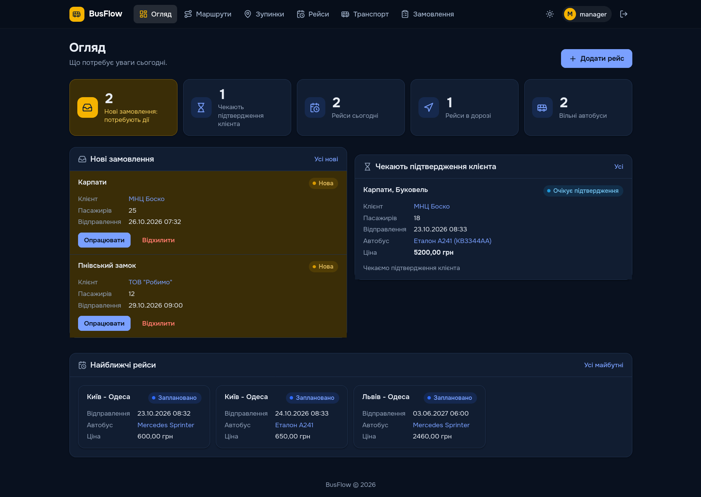

# BusFlow - система керування автобусними перевезеннями



Web-додаток на Django для пасажирських перевезень: менеджер планує маршрути,
зупинки, автобуси та рейси, клієнт замовляє автобус і стежить за своїми
поїздками. Реальна траса маршруту малюється на карті по вулицях, статуси
оновлюються автоматично, квитки створюються за місткістю автобуса.

## Зміст

- [Можливості](#можливості)
- [Технології](#технології)
- [Структура проєкту](#структура-проєкту)
- [База даних](#база-даних)
- [Запуск](#запуск)
- [Перевірка](#перевірка)
- [Карти](#карти)
- [Дизайн-система](#дизайн-система)

## Можливості

Система має три ролі:

| Роль              | Що бачить і робить                                                                                                             |
| ----------------- | ------------------------------------------------------------------------------------------------------------------------------ |
| **Клієнт**        | Замовляє автобус (заявка), підтверджує або відмовляється від запропонованих умов, бачить свої замовлення та рейси              |
| **Менеджер**      | Дашборд-огляд, довідники (маршрути, зупинки, транспорт), планування рейсів, опрацювання замовлень, продаж і повернення квитків |
| **Адміністратор** | Вбудована адмін-панель Django: користувачі, групи, створення менеджерів в один крок, довідники та транзакційні таблиці         |

Ключові функції:

- **Дашборд менеджера** - показники "що потребує уваги": нові замовлення,
  замовлення, що чекають підтвердження клієнта, рейси на сьогодні, вільні
  автобуси; усе клікабельно й веде до відфільтрованого списку.
- **Маршрути й зупинки** - маршрут складається з зупинок у порядку проходження;
  назву можна не вказувати - вона згенерується з першої та останньої зупинки.
- **Карти** - на сторінках маршруту, рейсу та зупинки показується реальна траса
  по вулицях (сервіс OSRM) і номерні маркери зупинок; на формі створення
  маршруту - живе попереднє переглядання, на формі зупинки - вибір координат
  кліком по карті.
- **Рейси та квитки** - при створенні рейсу автоматично народжується
  `capacity` вільних квитків; менеджер продає квиток (ім'я та телефон
  пасажира) або повертає його у продаж.
- **Замовлення** - клієнт залишає заявку (напрям, дата, кількість пасажирів),
  менеджер призначає автобус і ціну, клієнт підтверджує. Замовлення з
  підтвердженим автобусом переводить транспорт в стан "Орендований".
- **Автоматичні статуси** - рейси самі переходять "Заплановано" -> "В дорозі"
  -> "Завершено" за розкладом, статуси автобусів виводяться з його поточних
  замовлень і рейсів.
- **Темна та світла тема** - перемикається у шапці, вибір зберігається в
  браузері; без спалаху при завантаженні.
- **Адаптивна верстка** - таблиці списків на телефоні стають картками,
  навігація згортається в меню.

## Технології

| Компонент         | Вибір                                                                       |
| ----------------- | --------------------------------------------------------------------------- |
| Мови              | Python 3.14, HTML (Django-шаблони), CSS, JavaScript                         |
| Фреймворк         | Django 6.1.2                                                                |
| База даних        | MySQL 8 (у Docker), драйвер PyMySQL, `utf8mb4`                              |
| Карти             | Leaflet 1.9.4 (локальні файли у `static/vendor/`), тайли OpenStreetMap (DE) |
| Геокодинг/роутинг | OSRM (публічний демо-сервер), результат кешується в БД                      |
| Шрифт             | Onest (Google Fonts)                                                        |
| Іконки            | Lucide (CDN)                                                                |
| Залежності        | Django, PyMySQL, cryptography, python-dotenv (див. `requirements.txt`)      |

Зовнішні бібліотеки мінімальні: ORM, форми, автентифікація та адмін-панель - з
коробки Django; карти працюють на локально покладених файлах Leaflet, без
збірки та без npm.

## Структура проєкту

```text
├── docker-compose.yml        # MySQL 8 (порт 127.0.0.1:3307, volume з даними)
├── requirements.txt          # залежності
├── .env                      # змінні середовища
├── .env.example              # шаблон змінних середовища
├── manage.py
├── project_BusFlow/
│   ├── settings.py           # налаштування проєкту
│   └── urls.py               # налаштування маршрутів
├── app_BusFlow/              # додаток
│   ├── models.py             # Моделі БД
│   ├── views.py              # CRUD-подання, дії з замовленнями, вхід за ролями
│   ├── urls.py               # маршрути додатку
│   ├── forms.py              # форми та формсет зупинок маршруту
│   ├── services.py           # автостатуси, генерація/продаж/повернення квитків
│   ├── routing.py            # траса OSRM, кеш RoutePath, дані для карт
│   ├── signals.py            # квитки на рейс, автостатуси транспорту
│   ├── mixins.py             # перевірки ролей (менеджер/клієнт)
│   ├── context_processors.py # прапорці ролей у шаблонах
│   └── templates/app_BusFlow/ # темплейти додатку
├── templates/                # загальні темплейти
├── static/
│   ├── css/style.css         # дизайн (світла/темна тема)
│   ├── js/                   # тема, меню, карти (map/stop_map/route_form)
│   └── vendor/leaflet/       # локальні файли Leaflet
└── README.md                 # це що ви зараз читаєте
```

## База даних

Схема БД повторює ERD з MySQL Workbench: назви таблиць (`stop`, `route`,
`trip`, ...), первинні ключі зі стовпцями на кшталт `trip_id` та довжини
полів збігаються з діаграмою. У коді PK залишається `id`/`pk` - Django сам
зберігає його в потрібний стовпець (`db_column`).

Застосунок працює з MySQL 8, який запускається Docker Compose:

```bash
docker compose up -d     # підняти БД (127.0.0.1:3307)
docker compose down      # зупинити (дані лишаються у volume)
docker compose down -v   # зупинити разом з даними
```

Паролі не зберігаються в репозиторії: `docker-compose.yml` читає
`DB_PASSWORD` і `MYSQL_ROOT_PASSWORD` з `.env` і відмовляється стартувати без
них. Стара SQLite-база після міграції на MySQL вилучена - дані живуть лише в
MySQL (рекомендується робити `mysqldump`).

## Запуск

Потрібні Python 3.14+, Docker з Docker Compose.

```bash
# 1. Залежності
python -m venv .venv
source .venv/bin/activate        # Windows: .venv\Scripts\activate
pip install -r requirements.txt

# 2. Налаштування
cp .env.example .env             # Windows: copy .env.example .env
#   відредагуйте .env: DB_PASSWORD, MYSQL_ROOT_PASSWORD,
#   DJANGO_SECRET_KEY (випадковий рядок), DJANGO_DEBUG=1 для розробки

# 3. База даних
docker compose up -d
python manage.py migrate
python manage.py createsuperuser   # акаунт адміністратора

# 4. Запуск
python manage.py runserver          # http://127.0.0.1:8000/
```

Далі увійдіть під адміністратором і створіть менеджера: розділ
**Менеджери** -> "Додати менеджера" - група "Менеджери" та `is_staff`
призначаються автоматично, потрібні лише ім'я, прізвище та пароль. Акаунти
клієнтів створюються самообслуговуванням на сторінці реєстрації.

Щоб мати демо-дані (зупинки, маршрут, автобус, рейси), створіть їх через
адмін-панель або інтерфейс менеджера.

## Перевірка

```bash
python manage.py check     # системні перевірки Django
```

## Карти

- Leaflet 1.9.4 лежить у `static/vendor/leaflet/` - жодної збірки чи CDN для
  карти; потрібен лише інтернет для тайлів OpenStreetMap.
- Тайли: `tile.openstreetmap.de` (дані OSM, без ключа і без блокувань;
  `tile.openstreetmap.org` блокує застосунки без User-Agent).
- Траса між зупинками рахується публічним демо-сервером OSRM і кешується в
  таблиці `route_path` (ключ - відбиток координат зупинок, тож зміна
  маршруту інвалідує кеш). Якщо сервіс недоступний - показується пряма лінія
  між зупинками.
- Налаштування в `project_BusFlow/settings.py`: `MAP_ROUTING_ENABLED`
  (вимкнути зовнішні запити), `OSRM_URL`, `OSRM_TIMEOUT`.

## Дизайн-система

- Світла/темна тема через `data-theme` на `<html>`, усі кольори - CSS-змінні в
  `:root` (`static/css/style.css`).
- Шрифт Onest та іконки Lucide підключаються з CDN у `templates/base.html`.
- Таблиці списків мають клас `stack-table` і на телефоні перетворюються на
  картки; сортування колонок і швидкий пошук працюють без серверних запитів
  (`static/js/app.js`).
- Статуси мають кольорові бейджі: фільтр `status_slug` +
  класи `.badge-<ключ>` у `style.css`.
